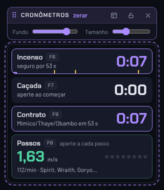
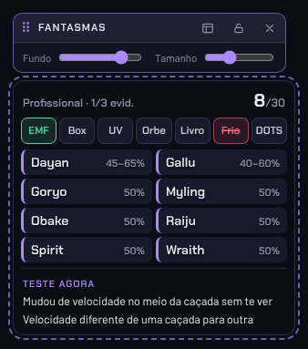

# HelpaEuPhasmo 👻

Overlay ajudante para **Phasmophobia** que fica por cima do jogo e te ajuda a descobrir o fantasma — com evidências **ou sem nenhuma evidência**. Interface em português, dados conferidos para a versão **v0.19.x (outubro de 2026)**, com os **30 fantasmas** (incluindo Dayan, Gallu, Obambo, Kormos, Aswang e Deildegast).


## O que ele faz

- **Dashboard para investigar**: evidências em cima (teclas 1–7), só os fantasmas possíveis no meio, cronômetros e comportamentos ao lado. Guia e Ajustes ficam em abas separadas, fora da tela de jogo.
- **Novo contrato em 2 cliques**: dificuldade (Amador, Intermediário, Profissional, Pesadelo, Insanidade, Personalizada ou **Sem evidências**) + tamanho do mapa, e Enter. "Repetir último" faz em 1 clique. Em "Mais opções": velocidade do fantasma e host abaixo do nível 30 (Deogen).
- **Evidências inteligentes**: considera quantas evidências a dificuldade mostra, as **evidências garantidas** (Goryo/D.O.T.S., Hantu/Congelante, Obake/UV, Deogen e Moroi/Spirit Box) e os **orbes falsos do Mímico**.
- **Sem evidências**: as 7 evidências dão lugar a **sinais únicos** de um fantasma só (orbe → Mímico, grito no parabólico → Banshee, apagou a luz → Mare, 6 dedos → Obake, respiração fria → Hantu, explosão → Poltergeist, respiração no Spirit Box → Deogen, porta + 15% → Yurei, sumiu na foto → Phantom, EMF no chão → Wraith).
- **~60 comportamentos** com busca (`/`): digite "sal", "rápido", "luz"… O app mostra os testes que mais separam os fantasmas que sobraram.
- **Sanidade na caçada**: diga a maior sanidade média em que ele caçou e o app elimina quem não caça nessa faixa.
- **Cronômetros** com atalhos globais: **incenso** (marcas de 60/90/180 s), **caçada** (duração esperada e cooldown de 25 s), **contrato** (fases do Obambo) e **contador de passos** (aperte a cada passo que ouvir: m/s, passos por minuto e quais fantasmas batem). Quando um cronômetro vê algo suspeito (Demon, Obambo), ele sugere a marcação.
- **Detalhe do fantasma** em gaveta lateral: como testar (conclusivo / forte / dica), como identificar sem evidência, habilidades, com quem é confundido e sobrevivência.
- **Dois HUDs para o jogo**, cada um numa janela própria: **Cronômetros** e **Fantasmas** (evidências ou sinais, possíveis e teste sugerido). Arraste para onde quiser, ajuste **fundo** (até 0%, só o texto) e **tamanho**, escolha o que cada um mostra e **trave cada um separado**.
- Tudo é salvo automaticamente: partida, posição dos HUDs e ajustes.

<p align="center"> &nbsp; </p>

## Como usar com o jogo

1. No Phasmophobia, vá em **Opções → Vídeo → Modo de tela** e escolha **Janela sem bordas** (Borderless). Em tela cheia exclusiva nenhum overlay aparece por cima.
2. Abra o HelpaEuPhasmo, escolha o contrato e aperte **H** (ou `Ctrl + Alt + D`) para o **Modo jogo**.
3. Arraste cada HUD pela barra de cima, ajuste fundo e tamanho e clique no **cadeado** para travar (ou `F10` trava os dois). Travado, o mouse passa direto para o jogo.
4. Para destravar: passe o mouse no **cadeadinho** no canto do HUD e clique, ou aperte `F10`.

**Nunca fica sem saída**: o `F10` destrava, o ícone na bandeja tem **Destravar tudo** (um clique no ícone também destrava) e abrir o app de novo destrava tudo. No Dashboard, o clique-através mostra uma pílula amarela com o botão **Sair**, que continua clicável.

| Ação | Atalho padrão |
| --- | --- |
| Incenso | `F6` |
| Caçada começou / acabou | `F7` |
| Passo do fantasma (toque a cada passo) | `F8` |
| Cronômetro do contrato | `F9` |
| Travar / destravar (HUDs ou clique-através) | `F10` |
| Marcar evidência 1–7 (sem evidência: sinais 1–0) | `Alt + 1…7` |
| Dashboard ↔ Modo jogo | `Ctrl + Alt + D` |
| Mostrar / ocultar tudo | `Ctrl + Alt + H` |
| Novo contrato | `Ctrl + Alt + N` |
| Zerar cronômetros | `Ctrl + Alt + 0` |

No Dashboard: `1–7` evidências (Shift ou botão direito descarta), `/` busca comportamento, `N` novo contrato, `H` Modo jogo, `Esc` fecha. Todos os atalhos globais podem ser trocados em **Ajustes → Atalhos**.

> O overlay é só um conjunto de janelas por cima do jogo: ele não lê nem altera nada do Phasmophobia.

## Baixar pronto

Baixe o `.exe` na página de [Releases](https://github.com/Ducifer01/HelpaEuPhasmo/releases):

- **HelpaEuPhasmo-x.y.z-portable.exe** — não precisa instalar, é só abrir (recomendado).
- **HelpaEuPhasmo-x.y.z-win-x64.zip** — a mesma versão em pasta: extraia e abra `HelpaEuPhasmo.exe` (abre mais rápido que o portátil).

O Windows pode mostrar o aviso "O Windows protegeu o computador" porque o app não é assinado digitalmente: clique em **Mais informações → Executar assim mesmo**.

## Rodar e buildar no seu PC

Pré-requisitos: [Node.js 20+](https://nodejs.org/) e Git.

```bash
git clone https://github.com/Ducifer01/HelpaEuPhasmo.git
cd HelpaEuPhasmo
npm install
npm start                 # abre o overlay em modo de desenvolvimento
npm test                  # testes do motor de dedução
npm run build:portable    # gera dist/HelpaEuPhasmo-2.0.0-portable.exe (não precisa instalar)
npm run build:zip         # gera dist/HelpaEuPhasmo-2.0.0-win-x64.zip
npm run build             # gera os dois
npm run build:instalador  # instalador NSIS (rode no Windows; no Linux exige wine 32-bit)
```

O build também funciona no Linux/macOS para gerar o `.exe` de Windows (o electron-builder baixa o que precisa).

## Estrutura

```
main.js                     processo principal: janelas (Dashboard + 2 HUDs), atalhos, bandeja, travas
preload.js                  ponte segura entre o Electron e as telas
src/index.html              Dashboard            src/js/dashboard.js   lógica do Dashboard
src/hud.html                HUDs (?k=t / ?k=f)   src/js/hud.js         lógica dos HUDs
src/js/estado.js            estado da partida e ações (evidências, sinais, cronômetros, passos)
src/js/motor.js             motor de dedução (evidências, características, velocidade)
src/js/ui.js                peças comuns da interface
src/styles.css, src/fonts/  visual e fontes embutidas (Chakra Petch e Barlow, SIL OFL)
src/data/                   fantasmas, características, evidências/dificuldades/mapas, guia
tests/                      testes do motor e do estado (npm test)
```

Quando sair uma atualização do jogo, normalmente basta editar os arquivos em `src/data/` e rodar `npm test`.

## Fontes

- [Notas de atualização oficiais (Kinetic Games)](https://kineticgames.co.uk/news) e [anúncios na Steam](https://steamcommunity.com/app/739630/announcements/)
- [Phasmophobia Wiki (Fandom)](https://phasmophobia.fandom.com/wiki/Ghost)
- [Phasmopedia](https://phasmopedia.com/en/) — dados verificados na v0.19.0.2

Projeto de fãs, sem afiliação com a Kinetic Games. Phasmophobia é marca da Kinetic Games.
