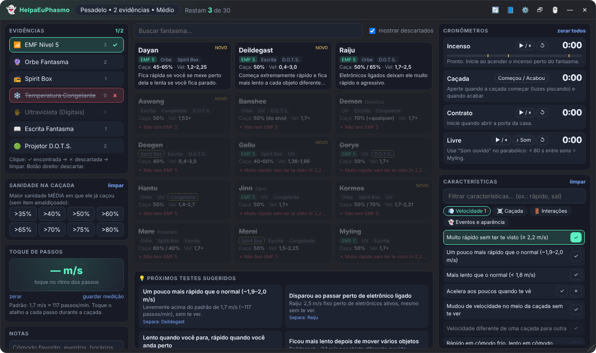
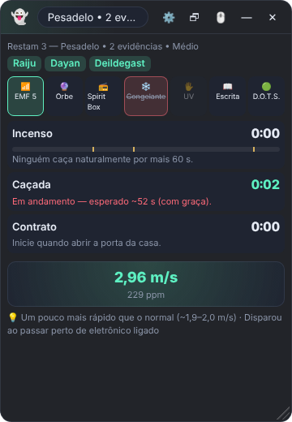
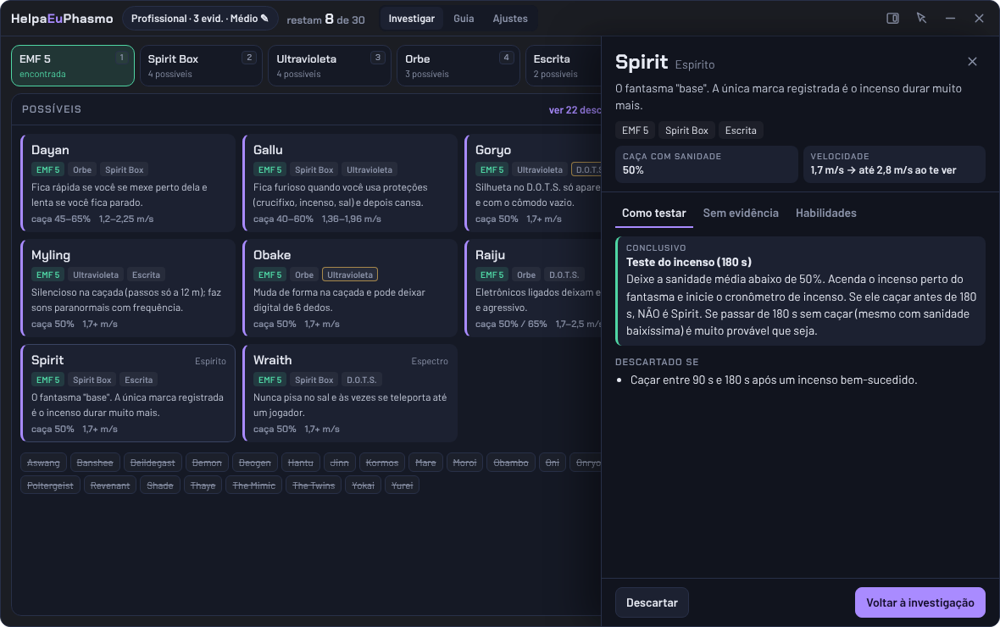

# HelpaEuPhasmo 👻

Overlay ajudante para **Phasmophobia** que fica por cima do jogo e te ajuda a descobrir o fantasma — com evidências **ou sem nenhuma evidência**. Interface em português, dados conferidos para a versão **v0.19.x (outubro de 2026)**, com os **30 fantasmas** (incluindo Dayan, Gallu, Obambo, Kormos, Aswang e Deildegast).



## O que ele faz

- **Configuração do contrato**: pergunta se você está jogando com evidências, a dificuldade (Amador, Intermediário, Profissional, Pesadelo, Insanidade, Personalizada ou Apocalipse), o tamanho do mapa, a velocidade do fantasma (personalizada), Lua de Sangue e se o host está abaixo do nível 30 (Deogen).
- **Evidências inteligentes**: marca ✓ encontrada ou ✗ descartada. Considera quantas evidências a dificuldade mostra, as **evidências garantidas** (Goryo/D.O.T.S., Hantu/Congelante, Obake/UV, Deogen e Moroi/Spirit Box) e os **orbes falsos do Mímico** (orbe em contrato sem evidências = Mímico).
- **~60 características de comportamento** com 3 estados (sim / não / neutro), separadas em Velocidade, Caçada, Interações e Eventos. Ex.: "Muito rápido sem ter te visto" deixa só os fantasmas que ficam rápidos; "Pisou no sal" descarta o Wraith; "Fantasma acendeu uma luz" descarta a Mare.
- **Sanidade na caçada**: diga a maior sanidade média em que ele já caçou e o app elimina quem não caça nessa faixa.
- **Toque de passos**: aperte o atalho a cada passo do fantasma durante a caçada e veja a velocidade em m/s e quais fantasmas batem (com ou sem visão de você).
- **Cronômetros**:
  - **Incenso**: marcas em 60 s (Demon), 90 s (normal) e 180 s (Spirit).
  - **Caçada**: duração de cada caçada comparada com a esperada (aponta Obambo) e cooldown de 25 s (aponta Demon).
  - **Contrato**: desde a porta aberta — mostra as fases calmo/agressivo do Obambo.
  - **Livre**: com botão "Som ouvido" para medir o intervalo entre sons paranormais (Myling).
  - Quando um cronômetro detecta algo suspeito, aparece uma sugestão para marcar a característica.
- **Card de cada fantasma** (clique): números, força/fraqueza, habilidades, sinais, **como testar** (conclusivo / forte / dica), **como identificar sem evidência**, com quem é confundido, o que descarta e dicas de sobrevivência. Botão direito no card descarta/restaura manualmente.
- **Próximos testes sugeridos**: o app calcula quais testes melhor separam os fantasmas que sobraram.
- **Guia rápido**: dificuldades, mecânicas (caçada, detecção, incenso, crucifixo, sanidade), dicas de profissionais para jogar sem evidência, tabela de evidências, itens amaldiçoados e fontes.
- **HUD compacto** para deixar num canto da tela durante a partida, e **Dashboard completo** para investigar.
- Tudo é salvo automaticamente (fechou o app, abriu de novo, continua de onde parou).

<p align="center"> &nbsp; </p>

## Como usar com o jogo

1. No Phasmophobia, vá em **Opções → Vídeo → Modo de tela** e escolha **Janela sem bordas** (Borderless). Em tela cheia exclusiva nenhum overlay consegue aparecer por cima.
2. Abra o HelpaEuPhasmo. Ele fica sempre por cima do jogo.
3. Use os atalhos globais (funcionam mesmo com o jogo em foco):

| Ação | Atalho padrão |
| --- | --- |
| Mostrar / ocultar o overlay | `Ctrl + Alt + H` |
| Clique-através (o mouse passa para o jogo) | `Ctrl + Alt + C` |
| Alternar Dashboard / HUD compacto | `Ctrl + Alt + D` |
| Novo contrato | `Ctrl + Alt + N` |
| Cronômetro de incenso | `F6` |
| Caçada começou / terminou | `F7` |
| Toque de passos | `F8` |
| Cronômetro livre | `F9` |
| Zerar cronômetros | `Ctrl + Alt + 0` |

Todos os atalhos podem ser trocados em ⚙️ **Configurações** (também dá para ajustar a opacidade e o tamanho da interface). Arraste a janela pela barra de cima e redimensione pelo canto inferior direito. O ícone na bandeja do Windows também mostra/oculta e liga o clique-através.

> O overlay é só uma janela comum por cima do jogo: ele não lê nem altera nada do Phasmophobia.

## Baixar pronto

Baixe o `.exe` na página de [Releases](https://github.com/Ducifer01/HelpaEuPhasmo/releases):

- **HelpaEuPhasmo-x.y.z-portable.exe** — não precisa instalar, é só abrir (recomendado).
- **HelpaEuPhasmo-x.y.z-win-x64.zip** — a mesma versão em pasta: extraia e abra `HelpaEuPhasmo.exe` (abre mais rápido que o portátil).

O Windows pode mostrar o aviso "O Windows protegeu o computador" porque o app não é assinado digitalmente: clique em **Mais informações → Executar assim mesmo**.

## Rodar e buildar no seu PC

Pré-requisitos: [Node.js 20+](https://nodejs.org/) e Git.

```bash
git clone https://github.com/Ducifer01/HelpaEuPhasmo.git
cd HelpaEuPhasmo
npm install
npm start                 # abre o overlay em modo de desenvolvimento
npm test                  # testes do motor de dedução
npm run build:portable    # gera dist/HelpaEuPhasmo-1.0.0-portable.exe (não precisa instalar)
npm run build:zip         # gera dist/HelpaEuPhasmo-1.0.0-win-x64.zip
npm run build             # gera os dois
npm run build:instalador  # instalador NSIS (rode no Windows; no Linux exige wine 32-bit)
```

O build também funciona no Linux/macOS para gerar o `.exe` de Windows (o electron-builder baixa o que precisa).

## Estrutura

```
main.js                    processo principal do Electron (janela, atalhos, bandeja)
preload.js                 ponte segura entre o Electron e a interface
src/index.html             interface
src/styles.css             visual
src/js/app.js              lógica da interface, cronômetros, modais
src/js/motor.js            motor de dedução (evidências, características, velocidade)
src/data/fantasmas.js      os 30 fantasmas: evidências, velocidades, sanidade, testes, dicas
src/data/caracteristicas.js comportamentos que filtram os fantasmas
src/data/evidencias.js     evidências, dificuldades e mapas
src/data/guia.js           mecânicas, dicas pro e itens amaldiçoados
tests/motor.test.js        testes automatizados
```

Quando sair uma atualização do jogo, normalmente basta editar os arquivos em `src/data/` e rodar `npm test`.

## Fontes

- [Notas de atualização oficiais (Kinetic Games)](https://kineticgames.co.uk/news) e [anúncios na Steam](https://steamcommunity.com/app/739630/announcements/)
- [Phasmophobia Wiki (Fandom)](https://phasmophobia.fandom.com/wiki/Ghost)
- [Phasmopedia](https://phasmopedia.com/en/) — dados verificados na v0.19.0.2

Projeto de fãs, sem afiliação com a Kinetic Games. Phasmophobia é marca da Kinetic Games.
